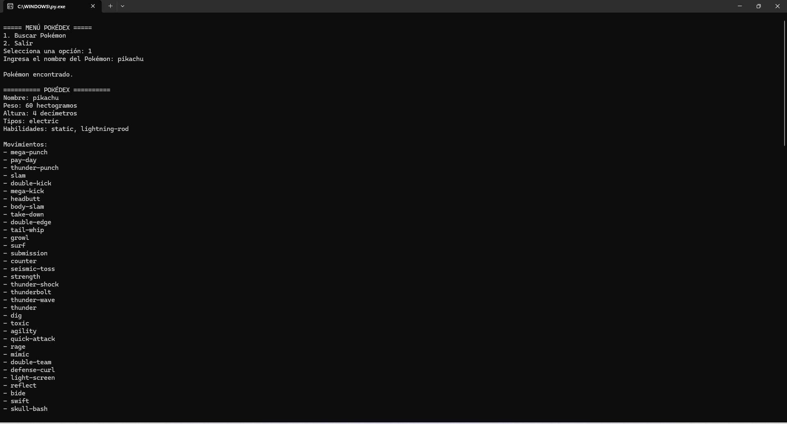
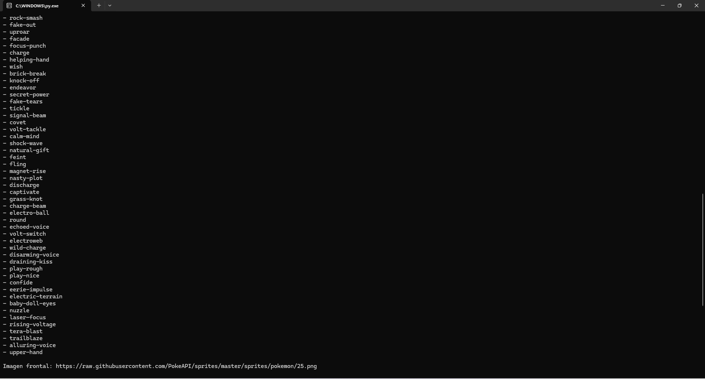

# Proyecto final: Pokédex con Python

Aplicación de consola que consulta la [PokéAPI](https://pokeapi.co/) mediante HTTP GET, muestra estadísticas y guarda cada consulta exitosa en JSON.

## Requisitos
- Python 3.10 o superior
- Internet
- Biblioteca `requests`

## Instalación
```bat
py -m pip install -r requirements.txt
```

## Ejecución
```bat
py pokedex_final.py
```
Selecciona `1`, escribe `pikachu` y presiona Enter. El programa muestra nombre, peso (hectogramos), altura (decímetros), tipos, habilidades, movimientos y la URL de la imagen frontal. Cada búsqueda exitosa crea un JSON nuevo en `pokedex/`. Selecciona `2` para salir.

## Manejo de errores
- HTTP 200: Pokémon encontrado.
- HTTP 404: Pokémon no encontrado.
- Otros estados HTTP: se informa el código.
- Timeout: la solicitud tiene un límite de 10 segundos.
- Fallos de red: se captura `RequestException`.

## Archivos
- `pokedex_final.py`: programa principal comentado.
- `requirements.txt`: dependencias.
- `pokedex/`: archivos JSON generados durante las consultas.
- `evidencias/`: capturas reales de la ejecución para agregar antes de entregar.


## Ejemplo de búsqueda exitosa

Al ejecutar el programa y consultar Pikachu,
se obtiene la siguiente información:

```text
===== MENÚ POKÉDEX =====
1. Buscar Pokémon
2. Salir

Selecciona una opción: 1
Ingresa el nombre del Pokémon: pikachu

Pokémon encontrado.
Nombre: pikachu
Peso: 60 hectogramos
Altura: 4 decímetros
Tipos: electric
Habilidades: static, lightning-rod
```

El programa también muestra los movimientos
y la URL de la imagen frontal del Pokémon.

Cada consulta exitosa genera un archivo JSON
individual dentro de la carpeta pokedex.


## Evidencias reales de ejecución

A continuación se muestran las evidencias obtenidas durante la ejecución del programa. Se realizó una consulta de Pikachu utilizando la PokéAPI y se verificó la información recuperada, incluyendo sus estadísticas, movimientos y el archivo JSON generado.

### Búsqueda exitosa de Pikachu



### Movimientos e imagen frontal



### Archivo JSON generado


## Librerías utilizadas

- `requests`: realiza solicitudes HTTP a PokéAPI. Es la única dependencia externa y se instala desde `requirements.txt`.
- `os`: crea carpetas y construye rutas de archivos (incluida en Python).
- `json`: lee y escribe datos JSON (incluida en Python).
- `datetime`: genera marcas de tiempo para cada archivo (incluida en Python).

## Publicar en GitHub
1. Entra a https://github.com/new e inicia sesión.
2. Crea un repositorio público llamado `pokedex-python`.
3. Abre el repositorio, selecciona **Add file > Upload files** y sube los archivos y carpetas del proyecto (con las capturas reales y al menos un JSON generado).
4. Selecciona **Commit changes**.
5. Comprueba que las imágenes aparecen en el README de la página principal.

Sube `pokedex_final.py`, `requirements.txt`, `README.md`, la carpeta `pokedex/` con JSON generados y `evidencias/` con tus capturas. No incluyas credenciales ni datos personales.

## Fuente de datos
[PokéAPI](https://pokeapi.co/)
